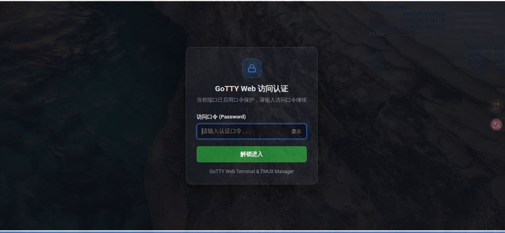
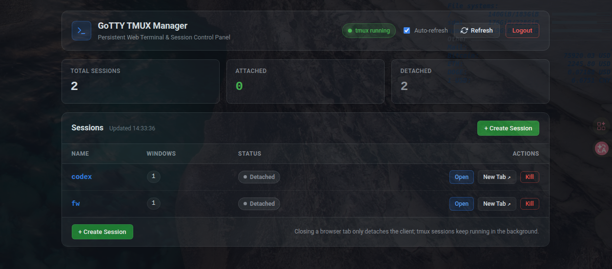

# GoTTY - Web 终端与 tmux 动态会话管理平台

[](./LICENSE)
[](https://go.dev/)

GoTTY 是一款轻量级、单二进制文件的 Web 终端服务工具。本项目在原版 [yudai/gotty](https://github.com/yudai/gotty) 的基础上进行了增量增强，新增了 **`--tmux` 动态多会话管理模式**、**`/manager` 可视化 Web 管理面板** 以及 **`--password` Web 访问口令认证**，实现通过**单个 GoTTY 进程、单个端口**在浏览器中创建、连接、共享和管理所有持久化 `tmux` 会话，同时 100% 保留原版 GoTTY 单命令共享模式的全部能力。




---

## 目录

- [核心特性](#核心特性)
- [环境要求与编译安装](#环境要求与编译安装)
- [快速开始](#快速开始)
- [路由设计与使用指南](#路由设计与使用指南)
- [REST API 接口文档](#rest-api-接口文档)
- [Web 访问口令认证（--password）](#web-访问口令认证--password)
- [架构设计与生命周期](#架构设计与生命周期)
- [命令行参数参考](#命令行参数参考)
- [配置文件（~/.gotty）](#配置文件gotty)
- [Nginx 反向代理配置](#nginx-反向代理配置)
- [项目结构与测试](#项目结构与测试)
- [开源协议](#开源协议)

---

## 核心特性

- **单进程多会话管理（`--tmux`）**：无需为每个终端分配独立端口或启动多个 GoTTY 实例，一个进程即可承载任意数量的持久化 `tmux` 会话。
- **URL 动态即开即连**：浏览器直接访问 `/<session_name>`（如 `/aaa`、`/codex`、`/jarvis`），若 Session 不存在则自动创建并连接，若已存在则直接接入历史现场。
- **真正的持久化会话**：严格隔离 `tmux Client`（浏览器连接）与 `tmux Server`（后台会话）。关闭浏览器标签页甚至重启 GoTTY 服务，Session 内的编译、训练、运维任务均继续在后台运行，随时重连恢复。
- **多端实时协同**：支持多个浏览器标签页或不同设备同时连接同一个 Session，实时共享终端输入输出并自动同步窗口尺寸（`TIOCSWINSZ`）。
- **内置 `/manager` 可视化面板**：零外部 CDN 依赖的暗色运维风格管理后台，支持实时查看会话状态（`Attached` / `Detached`）、窗口数、手动/定时刷新、新建会话、一键打开终端及带二次确认的销毁操作，完整适配桌面端与移动端。
- **按需启用的 Web 口令认证（`--password`）**：传递 `--password <口令>` 即自动启用登录页与 `HMAC-SHA256` 签名会话保护（全面拦截未授权页面、REST API 与 WebSocket 握手）；未传递参数则保持免密直连。
- **全量向后兼容**：不加 `--tmux` 时与原版 GoTTY 行为完全一致，保留 xterm.js / hterm、HTTP Basic Auth（`-c`）、TLS/HTTPS（`-t`）、双向客户端证书（`--tls-ca-crt`）等全部特性。

---

## 环境要求与编译安装

### 运行依赖

- **操作系统**：Linux / macOS / FreeBSD（依赖 POSIX PTY）
- **tmux**：使用 `--tmux` 模式时需预装 `tmux`（建议 2.6+ / 3.x）
  ```bash
  # Debian / Ubuntu
  sudo apt-get update && sudo apt-get install -y tmux

  # CentOS / RHEL / Rocky
  sudo dnf install -y tmux

  # macOS
  brew install tmux
  ```

### 从源码编译

项目已内置 `vendor/` 依赖与嵌入式前端静态资源（`//go:embed` 及 `asset.go`），克隆后可直接离线编译为单个独立可执行文件：

```bash
git clone <your-repo-url> gotty
cd gotty

# 编译生成 gotty 二进制文件
go build -o gotty .
```

---

## 快速开始

### 1. 启动 tmux 动态管理模式（免密访问）

```bash
./gotty -p 8080 --tmux
```

启动后打开浏览器访问：
- 管理面板：`http://127.0.0.1:8080/manager`（访问根路径 `http://127.0.0.1:8080/` 会自动跳转）
- 动态创建/连接指定终端：`http://127.0.0.1:8080/codex`、`http://127.0.0.1:8080/dev`

### 2. 启动 tmux 模式并开启 Web 口令认证（推荐公网/团队环境）

传递 `--password` 参数即启用口令保护；不传该参数则不启用：

```bash
./gotty -p 8080 --tmux --password your_strong_password
```

### 3. 同时启用 TLS (HTTPS/WSS) 与口令认证

```bash
# 生成自签名证书（如无现成证书）
openssl req -x509 -nodes -days 3650 -newkey rsa:2048 \
  -keyout ~/.gotty.key -out ~/.gotty.crt -subj "/CN=localhost"

# 启动加密服务
./gotty -p 8443 --tls --tls-crt ~/.gotty.crt --tls-key ~/.gotty.key \
  --tmux --password your_strong_password
```

### 4. 原版单命令模式（完全兼容旧版用法）

不携带 `--tmux` 参数时，GoTTY 保持原有单命令共享行为：

```bash
# 只读共享系统监控（默认禁止客户端键盘输入）
./gotty -p 8080 top

# 允许客户端交互输入（-w），并启用口令保护
./gotty -p 8080 -w --password your_strong_password bash

# 为每个连接客户端分配独立的一次性 Docker 容器
./gotty -p 8080 -w docker run -it --rm alpine sh
```

---

## 路由设计与使用指南

在 `--tmux` 模式下，HTTP/WebSocket 路由结构如下：

| 方法 | 路径 | 说明 |
|---|---|---|
| `GET` | `/` | 自动 `302` 重定向至 `/manager` |
| `GET` | `/manager` | tmux Web 可视化管理面板 |
| `GET` | `/{session}` | 访问名为 `{session}` 的终端页面（不存在则自动创建，已存在则直接连接） |
| `GET` (WS) | `/{session}/ws` | 对应 `{session}` 的 WebTTY WebSocket 实时终端流 |
| `GET` | `/list` | 获取当前所有 tmux Session 列表（JSON） |
| `GET` | `/api/tmux/sessions` | 获取当前所有 tmux Session 列表（JSON） |
| `POST` | `/api/tmux/sessions` | 创建新的持久化 tmux Session |
| `DELETE` | `/api/tmux/sessions/{name}` | 销毁指定的 tmux Session |
| `GET` | `/api/tmux/status` | 查询系统 tmux 安装与运行状态 |
| `GET / POST` | `/login` | Web 口令认证登录页与登录接口（仅在传入 `--password` 时生效） |
| `GET / POST` | `/logout` | 退出当前 Web 认证会话（仅在传入 `--password` 时生效） |
| `GET` | `/api/auth/status` | 查询当前端口口令认证启用状态与登录态 |

### Session 命名安全规则

- 合法字符正则：`^[a-zA-Z0-9_.-]+$`（长度 1～128 个字符）。
- 禁止使用路径穿越字符（`.`、`..`、`%2e`、`%2f`、`%5c`）。
- 系统保留路径名不可作为 Session 名称：`list`、`manager`、`api`、`ws`、`login`、`logout`、`auth`、`js`、`css`、`static`、`favicon.png`、`favicon.ico`、`auth_token.js`、`config.js`、`robots.txt`。
- *提示：`tmux` 底层在创建会话时会将名称中的 `.` 规范化为 `_`（如 `v1.0` 会存储为 `v1_0`），系统已自动做双向兼容映射。*

### `/manager` 管理面板功能

```text
+-------------------------------------------------------------------+
| GoTTY TMUX Manager     [tmux running] [Auto-refresh] [Refresh]    |
+-------------------------------------------------------------------+
| Total Sessions: 3          Attached: 1          Detached: 2       |
+-------------------------------------------------------------------+
| Sessions                                       [+ Create Session] |
|-------------------------------------------------------------------|
| Name        Windows    Status        Actions                      |
| aaa         1          Attached      [Open] [New Tab ↗] [Kill]    |
| codex       2          Detached      [Open] [New Tab ↗] [Kill]    |
| jarvis      1          Detached      [Open] [New Tab ↗] [Kill]    |
+-------------------------------------------------------------------+
```

- **实时状态与刷新**：支持右上角手动 `Refresh` 以及默认每 5 秒无感自动刷新（可随时勾选暂停）。
- **创建会话**：点击 `+ Create Session` 输入名称，可选择 **Create**（仅后台创建并刷新列表）或 **Create & Open**（创建后立即进入该终端）；重名时自动提示冲突（HTTP 409）。
- **打开会话**：支持 `Open`（当前标签页进入）和 `New Tab ↗`（新标签页打开）。
- **安全销毁**：点击 `Kill` 会弹出二次确认窗口并明确提示将终止该会话内的所有运行进程，确认后仅精确销毁目标会话（底层采用 `tmux kill-session -t =<name>` 精确匹配，绝不误伤同前缀会话）。

---

## REST API 接口文档

### 1. 获取会话列表

- **请求**：`GET /api/tmux/sessions` 或 `GET /list`
- **成功响应**（`200 OK`，即使无会话或 `tmux server` 尚未启动也稳定返回空数组）：
  ```json
  {
    "sessions": [
      {
        "name": "aaa",
        "windows": 1,
        "attached": 1
      },
      {
        "name": "codex",
        "windows": 2,
        "attached": 0
      }
    ]
  }
  ```

### 2. 创建会话

- **请求**：`POST /api/tmux/sessions`
  ```bash
  curl -X POST http://127.0.0.1:8080/api/tmux/sessions \
    -H "Content-Type: application/json" \
    -d '{"name": "codex"}'
  ```
- **响应**：
  - `200 OK`：`{"success": true, "name": "codex"}`
  - `409 Conflict`（已存在同名会话）：`{"success": false, "error": "session already exists: codex"}`
  - `400 Bad Request`（名称非法或为保留字）：`{"success": false, "error": "..."}`

### 3. 删除会话

- **请求**：`DELETE /api/tmux/sessions/{name}`
  ```bash
  curl -X DELETE http://127.0.0.1:8080/api/tmux/sessions/codex
  ```
- **响应**：
  - `200 OK`：`{"success": true}`
  - `404 Not Found`（目标会话不存在）：`{"success": false, "error": "session not found: codex"}`

### 4. 获取 tmux 服务状态

- **请求**：`GET /api/tmux/status`
- **成功响应**（`200 OK`）：
  ```json
  {
    "installed": true,
    "server_running": true,
    "session_count": 2
  }
  ```

---

## Web 访问口令认证（`--password`）

通过 `--password`（或环境变量 `GOTTY_PASSWORD`）可为整个 Web 端口开启口令保护：

- **启用条件**：仅当传递了非空 `--password` 参数（或在配置文件设置了 `password`）时启用；未传递时完全不启用认证。
- **浏览器访问流程**：未认证访问任意页面（如 `/`、`/manager`、`/codex`）会自动 `302` 跳转至 `/login?next=...`（在认证通过前**不会**触发动态 Session 创建）；输入正确口令后服务端下发 `HttpOnly` 的 `HMAC-SHA256` 签名会话 Cookie（有效期 24 小时），自动跳回原请求路径，并在 `/manager` 顶栏展示 `Logout` 按钮。
- **脚本与 API 调用方式**：当启用了 `--password` 时，`curl` 或自动化脚本可通过以下任一请求头直接认证调用 API：
  ```bash
  # 方式 1：Authorization Bearer 头
  curl -H "Authorization: Bearer your_password" http://127.0.0.1:8080/api/tmux/sessions

  # 方式 2：X-GoTTY-Password 头
  curl -H "X-GoTTY-Password: your_password" -X POST http://127.0.0.1:8080/api/tmux/sessions \
    -H "Content-Type: application/json" \
    -d '{"name": "ci-runner"}'
  ```

---

## 架构设计与生命周期

```text
                        Browser / API Client
                                 |
                                 v
                     +-----------------------+
                     |     GoTTY Server      |
                     |  TLS / Auth / Router  |
                     +-----------+-----------+
                                 |
         +-----------------------+-----------------------+
         |                       |                       |
   GET /manager          WS /aaa/ws              WS /codex/ws
   /api/tmux/*                   |                       |
         |                       v                       v
         |                 PTY Slave 1             PTY Slave 2
         |               (tmux client 1)         (tmux client 2)
         |                       |                       |
         v                       +-----------+-----------+
   TmuxManager                               |
  (exec.Command)                             v
         +-------------------------> +---------------+
                                     |  tmux Server  |
                                     +-------+-------+
                                             |
                                     +-------+-------+
                                     |               |
                                 Session: aaa   Session: codex
```

1. **进程隔离**：每个浏览器连接对应一个独立的 `PTY + tmux client`（执行 `tmux new-session -A -s <name>`），所有命令均通过参数数组直接调用，不经过任何 Shell 字符串拼接。
2. **安全断开**：浏览器关闭或网络中断时，GoTTY 仅向对应的 `tmux client` 发送 `SIGHUP`，客户端自动 Detach 退出，后台 `tmux Server` 与 `Session` 不受任何影响。
3. **环境自适应**：自动清理子进程环境变量中的 `TMUX` / `TMUX_PANE`（支持在已有 tmux 会话内启动 GoTTY），并在无 TTY 的后台服务环境（如 `systemd` / Docker，`TERM=dumb`）中自动注入 `TERM=xterm-256color`。

---

## 命令行参数参考

```text
用法:
   gotty [options] <command> [<arguments...>]
   gotty [options] --tmux
```

| 参数 | 简写 | 默认值 | 环境变量 | 说明 |
|---|---|---|---|---|
| `--tmux` | 无 | `false` | `GOTTY_TMUX` | 启用 tmux 动态 Session 管理模式与 `/manager` 面板 |
| `--password value` | 无 | `""` | `GOTTY_PASSWORD` | 设置 Web 访问口令（传参即启用登录认证，不传则不启用） |
| `--address value` | `-a` | `"0.0.0.0"` | `GOTTY_ADDRESS` | 监听的 IP 地址 |
| `--port value` | `-p` | `"8080"` | `GOTTY_PORT` | 监听的端口号（设为 `0` 随机分配端口） |
| `--permit-write` | `-w` | `false`* | `GOTTY_PERMIT_WRITE` | 允许客户端向终端写入输入（*注：`--tmux` 模式下默认开启） |
| `--credential value` | `-c` | `""` | `GOTTY_CREDENTIAL` | 启用 HTTP Basic Auth 认证（格式：`user:pass`） |
| `--random-url` | `-r` | `false` | `GOTTY_RANDOM_URL` | 在访问根路径附加随机字符串前缀 |
| `--random-url-length` | 无 | `8` | `GOTTY_RANDOM_URL_LENGTH` | 随机 URL 路径长度 |
| `--tls` | `-t` | `false` | `GOTTY_TLS` | 启用 TLS / HTTPS 加密 |
| `--tls-crt value` | 无 | `"~/.gotty.crt"` | `GOTTY_TLS_CRT` | TLS 证书文件路径 |
| `--tls-key value` | 无 | `"~/.gotty.key"` | `GOTTY_TLS_KEY` | TLS 私钥文件路径 |
| `--tls-ca-crt value` | 无 | `"~/.gotty.ca.crt"` | `GOTTY_TLS_CA_CRT` | 客户端双向认证 CA 证书路径（需配合 `--tls`） |
| `--title-format value` | 无 | `"{{ .command }}@{{ .hostname }}"` | `GOTTY_TITLE_FORMAT` | 浏览器窗口标题模板 |
| `--reconnect` | 无 | `false` | `GOTTY_RECONNECT` | 断开后在前端自动重连 |
| `--reconnect-time` | 无 | `10` | `GOTTY_RECONNECT_TIME` | 自动重连等待秒数 |
| `--max-connection` | 无 | `0` | `GOTTY_MAX_CONNECTION` | 最大并发连接数限制（`0` 为不限制） |
| `--once` | 无 | `false` | `GOTTY_ONCE` | 仅接受一次客户端连接，断开后自动退出服务 |
| `--timeout value` | 无 | `0` | `GOTTY_TIMEOUT` | 等待客户端连接的超时秒数（`0` 为禁用） |
| `--permit-arguments` | 无 | `true` | `GOTTY_PERMIT_ARGUMENTS` | 单命令模式下允许通过 URL `?arg=xxx` 追加命令行参数 |
| `--width value` | 无 | `0` | `GOTTY_WIDTH` | 固定终端列宽（`0` 为随浏览器动态调整） |
| `--height value` | 无 | `0` | `GOTTY_HEIGHT` | 固定终端行高（`0` 为随浏览器动态调整） |
| `--ws-origin value` | 无 | `""` | `GOTTY_WS_ORIGIN` | 允许跨域 WebSocket 连接的 Origin 正则表达式 |
| `--term value` | 无 | `"xterm"` | `GOTTY_TERM` | 浏览器终端渲染引擎：`xterm` 或 `hterm` |
| `--index value` | 无 | `""` | `GOTTY_INDEX` | 自定义终端页 `index.html` 文件路径 |
| `--close-signal value` | 无 | `1` (`SIGHUP`) | `GOTTY_CLOSE_SIGNAL` | 连接关闭时向子进程发送的信号 |
| `--close-timeout value` | 无 | `-1` | `GOTTY_CLOSE_TIMEOUT` | 断开后强制 `SIGKILL` 子进程的等待秒数 |
| `--config value` | 无 | `"~/.gotty"` | `GOTTY_CONFIG` | HCL 配置文件路径 |

---

## 配置文件（`~/.gotty`）

如果存在 `~/.gotty`（或通过 `--config` 指定路径），GoTTY 启动时会自动加载配置：

```hcl
address = "0.0.0.0"
port = "8080"

// 开启 tmux 动态管理模式
tmux = true

// 设置口令即自动开启 Web 认证（留空则不开启）
password = "your_strong_password"

// 断线自动重连
enable_reconnect = true
reconnect_time = 5
```

更多终端外观配置项可参考仓库根目录下的 [`.gotty`](./.gotty) 示例文件。

---

## Nginx 反向代理配置

本项目的前端资源、API 请求与 WebSocket 连接均采用相对路径自动推导，天然支持根路径及子路径（如 `/gotty/`）反向代理：

```nginx
location /gotty/ {
    proxy_pass http://127.0.0.1:8080/;
    proxy_http_version 1.1;

    # WebSocket 升级头
    proxy_set_header Upgrade $http_upgrade;
    proxy_set_header Connection "upgrade";

    # 传递真实协议与前缀（确保 HTTPS Cookie 与重定向路径准确）
    proxy_set_header Host $host;
    proxy_set_header X-Real-IP $remote_addr;
    proxy_set_header X-Forwarded-For $proxy_add_x_forwarded_for;
    proxy_set_header X-Forwarded-Proto $scheme;
    proxy_set_header X-Forwarded-Prefix /gotty;

    # 避免长连接空闲被代理主动断开
    proxy_read_timeout 3600s;
    proxy_send_timeout 3600s;
}
```

---

## 项目结构与测试

```text
gotty/
├── main.go                          # CLI 入口、参数解析与模式装配
├── help.go / version.go             # CLI 帮助模板与版本信息
├── backend/localcommand/            # 本地 PTY 进程管理与 TmuxFactory 实现
├── server/
│   ├── server.go / handlers.go      # HTTP/HTTPS/WebSocket 核心服务
│   ├── tmux_router.go               # --tmux 动态会话路由、管理页与 API 分发
│   ├── password_auth.go             # --password 口令登录、HMAC Cookie 与认证中间件
│   ├── middleware.go                # 日志、响应头与 Basic Auth 中间件
│   └── asset.go                     # 终端前端打包静态资源
├── tmux/
│   ├── session.go                   # 数据模型、保留字与安全名称校验
│   ├── manager.go                   # TmuxManager 接口与命令执行封装
│   └── handler.go                   # /list 与 /api/tmux/* REST Handler
├── web/
│   ├── embed.go                     # go:embed 静态资源嵌入声明
│   ├── manager.html / .css / .js    # /manager Web 管理面板前端源码
│   └── login.html                   # /login Web 口令认证登录页
└── webtty/                          # WebTTY 终端流协议层
```

运行全量单元测试与集成测试：

```bash
gofmt -w main.go help.go backend server tmux utils web webtty
go build ./...
go test -v ./...
```

---

## 开源协议

本项目基于 [MIT License](./LICENSE) 开源，致谢原作者 [Yudai Iwasaki](https://github.com/yudai) 及 [GoTTY](https://github.com/yudai/gotty) 社区。
